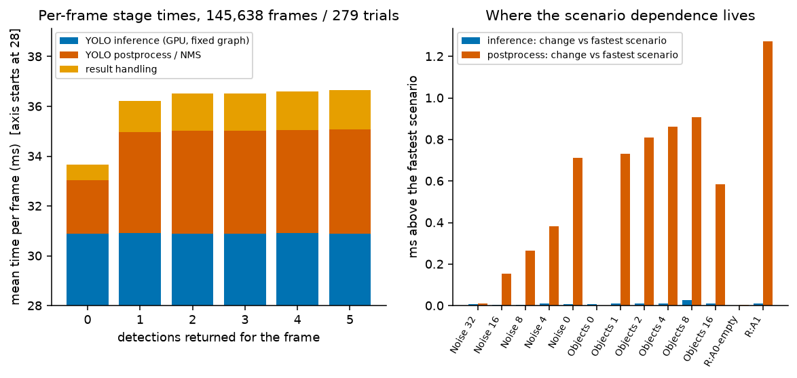
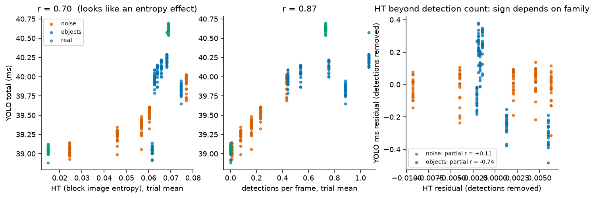
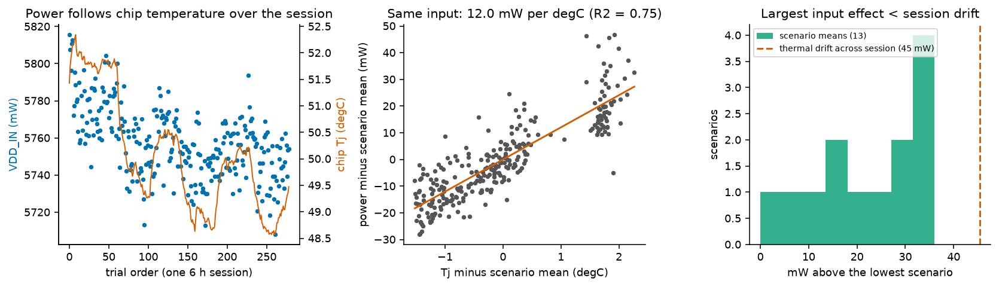
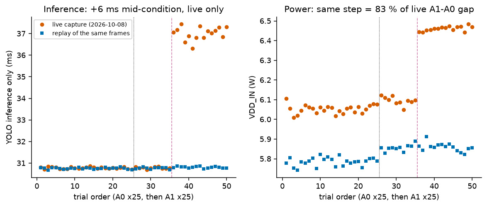
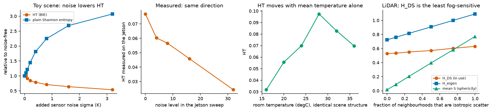
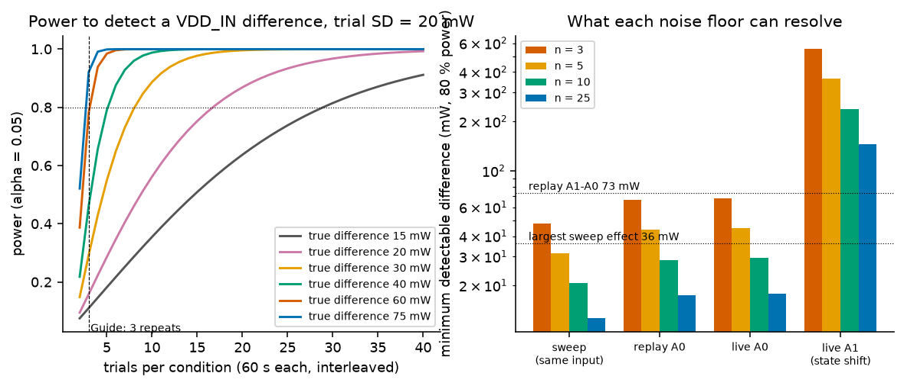

# Experiment audit: what is wrong with the study as it stands, and what to change

Track `experiment-audit`, overnight run 2026-11-23. Audience: Ali, the team lead, the advisor.
Everything here is re-analysis of data that already existed. Nothing new was measured on the Jetson.

**How to read the evidence tags.** *Measured* = computed tonight from existing recordings; the number is
in a file under `results/experiment-audit/` (named in brackets). *Drive* = read from a teammate's file in
the ThreatDet folder and not recomputed. *Probe* = a seeded toy calculation that tests a formula, not a
sensor. *Research track* = reported by the `research` agent from its literature check; not re-verified here.
*Reasoned* = an argument, not a measurement.

Reproduce: `PYTHONPATH=. python synthlab/audit/analyze_sweep.py && python synthlab/audit/analyze_heatlamp.py
&& python synthlab/audit/analyze_validity_power.py && python synthlab/audit/figures.py` (numpy, scipy,
pandas, matplotlib; seeds 1711 and 20261123). Tests: `pytest tests/test_audit_stats.py` (14 pass).

## 1. The five problems that matter most

| # | Problem | Evidence | Fix |
|---|---|---|---|
| 1 | **The detector's cost does not depend on the input. The only input-dependent time is a 2.6 ms step in post-processing when a frame has at least one detection.** Entropy adds nothing once that is accounted for. | Inference 30.90 ms, same-input SD 0.024 ms, slope 0.0002 ms per detection. Fraction of frames with a detection explains 97.5 % of trial YOLO time; HT partial r = 0.10, p = 0.10. [`sweep_mechanism.json`] | Stop testing "entropy -> YOLO cost". Add a stage whose work really scales with the data (LiDAR clustering, late fusion, high-candidate NMS) and make that the object of study. |
| 2 | **The headline live result is mostly an artefact.** 83 % of the live A1-A0 power gap comes from a system-state jump in the middle of the A1 block, not from the scene. | Live inference went 30.8 -> 37.0 ms and power +365 mW between A1 runs 10 and 11, same condition. Replaying the same frames shows no jump. [`heatlamp_live_vs_replay.json`, `fig_heatlamp_live_vs_replay.png`] | Report the replay numbers (73 mW, 3.6 ms), not the live ones. Interleave conditions; log CPU/GPU frequency and background processes every trial. |
| 3 | **HT (BIE) is not a measure of disorder.** It falls when noise rises and moves with room temperature alone. H_DS on the LiDAR side is not an isotropy measure either. | HT vs noise level in the Jetson sweep r = -0.98; toy probe: HT changes 3x from a uniform temperature offset. [`validity_and_power.json`, `bie_probe.csv`, `fig_metric_validity.png`]; `compute_hl.py` docstring (Drive). | Use plain Shannon entropy or noise-equivalent metrics for thermal, H_eigen / mean S / particle-tag fraction for LiDAR. Decide before the fog trials. |
| 4 | **The real effects are 0.6-1.3 % of module power, smaller than the session's own thermal drift**, and the Guide's "3 repeats" cannot detect them. | Largest effect 36 mW (sweep), 73 mW (replay). Drift 12.0 mW per degC x 3.8 degC = 45 mW. With 3 repeats the minimum detectable difference is 48-68 mW. [`power_analysis_table.csv`, `fig_drift.png`, `fig_power_analysis.png`] | Randomised blocks with every condition in every block; 10+ trials per condition; chip temperature as a covariate; pre-registered effect size. |
| 5 | **Experiment B as planned cannot produce the security result.** YOLO does not read the LiDAR; the only thing that does is the entropy node itself, so "fog costs power" would be the cost of measuring fog. And the entropy computations are about half the workload in both stacks. | BIE = 34.5 ms of 74.3 ms per frame (46 %). [`sweep_mechanism.json`]. HL about 350 ms per 1 s window, YOLO on webcam only (LiDAR Track Summary, Drive). | Remove the metrics from the measured process (compute offline from the recording). Put a real LiDAR consumer in the loop first. Pre-register B using the synthetic pipeline. |

The honest one-line status: **on the current pipeline the data support the null for the neural network
and a small "any detection vs none" post-processing effect; they do not support an entropy-driven or
security-relevant effect.** That is a publishable finding only if it is framed that way.

## 2. What the study claims and what each track measures today

### 2.1 Claims (Guide.docx, Drive)

- A: more real objects raise HL, HT and power. B: fog raises HL with HT flat and power still rises (the
  security claim). C: power vs entropy has a knee. Null: fixed graph, constant power.
- Design: AGX Orin as main rig, YOLOv8 as a TensorRT engine, ROS 2 with all streams in one rosbag on
  one clock, CT-3 external meter plus INA3221 rails, BME688, BNO085, radar witness, at least 3 repeats.

### 2.2 Gaps between the Guide and reality

| Guide | Reality | Why it matters |
|---|---|---|
| AGX Orin main, two Nanos for comparison | LiDAR pilot on AGX (Sept), then Orin Nano; thermal on Orin Nano only | Hypothesis C's hardware comparison does not exist. Tracks are on different boards. |
| YOLOv8 TensorRT | LiDAR stack: TensorRT engine, about 7-8 ms. Thermal stack: PyTorch CUDA FP32, 30.9 ms | Same "YOLO" label, 4x different cost and different post-processing share. Results do not transfer. |
| YOLO consumes the RGB camera; HT and HL are side measurements | Thermal stack runs YOLO on the thermal frame; LiDAR stack runs it on the webcam; neither consumes LiDAR | In the thermal stack the "control" sensor is also the workload. In the LiDAR stack fog has no path to the detector except through the RGB image. |
| One clock, one rosbag | Two unrelated pipelines; thermal is a single Python loop with CSV logs | No joint trial has ever been recorded. HL and HT have never been measured on the same scene. |
| CT-3 external meter as "the main security number" | tegrastats VDD_IN only, 2 Hz (119 samples per 60 s trial) | VDD_IN is module power: no carrier board, fan or sensors. Cannot be matched to frames. |
| Fog (B0-B3), radar, BME688, BNO085 | None done | The security hypothesis is untested. Layers 3 and 4 of the control do not exist. |
| A0-A3 (empty, 1 person, several, several + warm objects) | A0 and A1 only, and A1 = person + heat lamp together | Hypothesis A has two points; no dose-response; person and lamp are confounded. |
| Submit in August | Today is 23 November; Experiment B has not started | The plan needs re-scoping, not catching up. |
| "Pick one power mode and do not change it" | MAXN_SUPER, but CPU governor is `schedutil` (frequencies move 729-1728 MHz in the logs) and `jtop` runs in the background | Power mode is pinned; clocks are not. See problem 2. |

### 2.3 What exists as data

| Dataset | n | What it can answer |
|---|---|---|
| Live heat-lamp, Orin Nano, 2026-10-08 | 25 A0 + 25 A1, 60 s each, 25,808 frames | Nothing causal: all A0 first, then all A1. |
| Replay of the same frames, 2026-11-06 | 50 trials | Cleanest real-data comparison: identical input, fresh process per trial. |
| Synthetic sweep, 2026-11-16 | 279 trials, 13 scenarios x 21-22 rounds, 145,638 frames, 6.0 h | Mechanism: randomised within rounds, same input replicated about 21 times. |
| LiDAR pilot, AGX, 2026-09-13/14 (Drive) | 5 trials: 2 M0, 2 M1, 1 M2 | Too small for inference; shows day-to-day drift. Lab 5 x M0 + 5 x M1 from October is described in the summary but its comparison table was not found on Drive. |

## 3. Mechanism check: where could input-dependent cost come from?

A convolutional detector with a fixed input size does the same multiply-adds for every image. Cost can
only depend on the input through (a) code outside the network whose loop length depends on the data
(NMS, box scaling, result objects, clustering), (b) hardware effects of the data values (switching
activity; the research track cites GPU studies showing input-dependent power on fixed workloads),
or (c) the system reacting (DVFS, thermal throttling, frame drops). The data let us separate these.

### 3.1 Stage decomposition (measured, synthetic sweep)

| Stage | Mean (ms) | Depends on input? |
|---|---:|---|
| BIE / conversion (CPU) | 34.49 | Slightly, in the opposite direction (r = -0.76 with detections; range across scenarios 1.3 ms) |
| YOLO preprocess (CPU) | 5.16 | No |
| YOLO inference (GPU) | 30.90 | **No.** Same-input SD 0.024 ms; 30.900 ms with zero detections, 30.901 ms with any |
| YOLO postprocess (CPU) | 2.68 | **Yes: step.** 2.14 ms with 0 detections, 4.07-4.18 ms with 1 to 7 |
| Result handling | about 0.8 | Yes: 0.61 ms -> 1.26-1.60 ms |

[`sweep_mechanism.json`: `frame_level.by_count`, `frame_level.step_any_detection`, `duty_cycle`]

Three things follow.

1. **It is a step, not a slope.** Going from 1 to 7 detections adds 0.1 ms. Going from 0 to 1 adds
   2.6 ms in total. So the cost is not "more objects, more NMS work"; it is "the non-empty code path
   ran". Mean detections per frame (r = 0.87 with YOLO time) is the wrong covariate. The fraction of
   frames with at least one detection gives r = 0.987 (R2 = 0.975), slope 2.37 ms.
   [`step_model_any_detection`]
2. **HT does no work beyond that.** Partial correlation of HT with YOLO time given the detection
   fraction: r = 0.10, p = 0.10 over all 279 trials; 0.03 in the noise family. In the objects family it
   is 0.34, which reflects the remaining 0.1 ms count slope, since HT rises with object count there.
   Controlling only for mean count gives a partial r of +0.30 overall but -0.74 within objects and +0.11
   within noise: a sign that flips with the family is a covariate artefact, not an entropy effect.
   [`sweep_partial_correlations.csv`, `fig_partial_correlation.png`]
3. **The published r(HT, yolo_ms) = 0.70 is a by-product of how the scenarios were built.** Adding noise
   lowers both HT and detections; the empty real room has both low. HT and "has a detection" move
   together by construction.

The same picture holds on real frames. In the replay, inference is 30.756 ms (A0) vs 30.788 ms (A1), a
difference of 0.03 ms, while YOLO total differs by 3.61 ms. Within A1, HT does not predict replay YOLO
time (r = -0.10). [`heatlamp_live_vs_replay.json`]

### 3.2 Power: real, small, and smaller than drift (measured)

- **Size.** Scenario means span 36 mW (Real A1 vs Real A0), 18-29 mW for synthetic objects vs none, and
  **-17 mW at the highest noise level**: more disorder, less power, because detections vanish. Module
  power is 5.76 W, so the largest effect is 0.63 % (4.1 mJ per frame on about 662 mJ per frame).
  [`sweep_scenario_effects.csv`]
- **Noise floor.** Same input, about 21 repeats each: pooled trial-to-trial SD 15.6 mW; replay A0
  21.6 mW; live A0 22.2 mW. [`validity_and_power.json`: `noise_floors_mw`]
- **Drift.** Chip temperature fell 3.8 degC over the 6 h session and power followed at 12.0 mW per degC
  (R2 = 0.75 within scenario). That is 45 mW of drift against a 36 mW largest effect. Scenario-centred
  power has lag-1 autocorrelation 0.86, so the 279 trials carry about 21 independent pieces of
  information about slow noise. The first round sits 35 mW above the rest: the board was not warm.
  [`sweep_mechanism.json`: `drift`]
- **Does the effect survive?** Yes, because that sweep shuffled scenarios within each round. A
  permutation test that only shuffles within rounds gives p = 0.0002 for power vs detections, and round
  fixed effects leave the coefficients unchanged. With chip temperature in the model, power is
  50 mW x (fraction of frames with a detection) + 12 mW per degC, R2 = 0.80.
  [`blocked_permutation_by_round`, `step_model_any_detection.power_mw_on_frac_any_and_tj`]
- **Is HT doing anything for power?** Given detection fraction and temperature, HT has partial
  r = 0.17 (p = 0.004) pooled, but -0.05 within objects and -0.02 within noise. The pooled value comes
  from the between-family offsets (three different image sources), not from a dose-response. Treat as
  not established.

Latency is easy to measure and power is hard: the same-input SD of YOLO time is 0.075 ms against a
2.6 ms step (35 SD), whereas for power it is 16-22 mW against 18-73 mW (1-4 SD).

### 3.3 The live 50-trial result is confounded twice (measured)

| | Live inference (ms) | Replay inference (ms) | Live power (W) | Replay power (W) | Live CPU % |
|---|---:|---:|---:|---:|---:|
| A0, 25 trials | 30.78 | 30.76 | 6.052 | 5.785 | 12.1 |
| A1 runs 1-10 | 30.78 | 30.76 | 6.096 | 5.855 | 12.5 |
| A1 runs 11-25 | **37.01** | 30.80 | **6.461** | 5.859 | **18.9** |

[`heatlamp_live_vs_replay.csv`, `.json`]

- Between A1 run 10 and run 11 the fixed network became 6.2 ms slower, CPU use rose from 12.5 % to
  18.9 %, GPU activity from 29 % to 47 %, and power by 365 mW. The scene condition did not change, and
  the replay of those exact frames shows nothing. Something else started using the board (the cause is
  not in the logs; sound cues were introduced at run 12, one run later).
- The reported live A1-A0 gap is 263 mW. Using only A1 runs 1-10 it is 44 mW. **83 % of the reported gap
  is the state jump.** The reported YOLO difference of 9.1 ms shrinks to 4.2 ms.
- Independently of that, all A0 trials ran before all A1 trials (correlation of order with condition
  0.87), and A1 changed person and lamp together. Even the 44 mW cannot be attributed.
- Live power is 267 mW above replay power for the same frames, and the chip was 4.6 degC hotter. Camera
  capture, a longer-running process and temperature all differ, so live and replay watts are not
  interchangeable.

The replay is the number to quote for real frames: **A1 - A0 = 73 mW (1.3 %) and 3.6 ms, all of it
post-processing**, with the caveat that it is one batch and A0 was replayed before A1 there too.

### 3.4 Is an effect this size a battery-drain attack? (reasoned from measured numbers)

- 73 mW on 5.76 W is 1.3 %. If the Jetson module were the only load, that is about 6 minutes in an
  8-hour mission. On a robot with motors the share is smaller. [`validity_and_power.json`: `battery`]
- The whole perception pipeline costs about 0.98 W above idle (idle estimate from only 9 samples,
  SD 0.35 W, so treat as rough). Even a perfect attack on this pipeline at 8.7 fps is bounded near that.
- The "attack" that produces the effect is putting a person-like warm object in view, which is the
  detector doing its job. Adding disorder (noise) reduced cost.
- At 8.7 fps the pipeline is busy 65 % of each frame period and the GPU 27 %. A 2.6 ms slowdown is
  absorbed by idle time; no frame is late (1 late frame in 145,638). There is no latency consequence
  for the robot at this frame rate.

Conclusion: real and repeatable, but not meaningful as an attack on this workload.

## 4. Metric validity

### 4.1 HT = block image entropy (thermal)

`scripts/experimentA.py` implements
`BIE = ADP x mean(-M ln M) / (1 + mean block Shannon entropy) x global SD / (1 + mean block SD)`.
Per-block entropy and per-block SD are in the **denominators**. It is an image-quality score that
rewards global contrast with locally smooth blocks. Consequences:

- **Noise lowers it.** In the Jetson sweep HT falls 0.077 -> 0.060 -> 0.057 -> 0.046 -> 0.024 as noise
  level goes 0 -> 32 (r = -0.98). The toy probe agrees: HT drops 46 % at 3.2 K noise while plain Shannon
  entropy triples. [`validity_and_power.json`, `bie_probe.csv`]
- **It moves with mean temperature alone.** The ADP factor peaks when the image mean is mid-range,
  which with the fixed 10-50 degC mapping means 30 degC. Shifting an identical toy scene from 16 to
  28 degC changes HT from 0.032 to 0.097 (probe). A lamp warming the room, or FFC drift, changes HT with
  no change in structure. The live data show whole-image mean rising 1.34 degC from A0 to A1.
- **It mostly measures "is there a warm object".** Empty room 0.013-0.015; anything with a person
  0.06-0.08. Within A1 it does not track cost (section 3.1).
- **Sign problem for Hypothesis B.** If fog or mist adds low-contrast clutter to the thermal image, HT
  would fall, not rise. "HT flat" then has no agreed meaning. An equivalence margin must be set first.
- **Same data as the detector?** Yes for thermal: BIE and YOLO both use the 8-bit 10-50 degC image
  (clipped: 8.25 % of A1 frames had pixels above 50 degC, per the 50-run report). YOLO additionally
  upsamples 160x120 to 640. That part is sound.

### 4.2 HL (LiDAR)

- `compute_hl.py` (Drive) states it itself: H_DS, the Shannon entropy of (L, P, S), is zero for a line,
  a plane **and** isotropic scatter, and is "NOT an isotropy measure". The Guide's fog argument (points
  spread evenly in three directions push the entropy up) describes H_eigen, not H_DS. In the probe,
  replacing planar neighbourhoods by isotropic ones raises H_DS by 20 %, H_eigen by 51 % and mean S by
  50x. [`eigen_entropy_probe.csv`]. The pilot summary uses `H_DS` as the first metric.
- The pilot's separation is tiny: H_DS 0.7685 -> 0.7783 (M0 -> M1) on day 1, 0.7705 -> 0.7745 on day 2.
  The clutter effect (0.004-0.010) is 2-5x the day-to-day M0 shift (0.002) with n = 2.
  [`lidar_pilot_derived.csv`]
- Voxel downsampling is described as the density control so that HL reflects disorder, not point count.
  But then **compute cost** scales with the number of occupied voxels (about 12,000), which fog would
  increase by filling empty space. Cost would follow "more occupied voxels", not HL.
- The live node closes a window on the first message after 1.0 s, so windows alternate between 10 and
  11 messages (about 154k vs 170k raw points; compute about 261 vs 268 ms in the one `hl_live.csv`
  read from Drive). That is a 10 % periodic workload ripple unrelated to the scene.
- The entropy is computed on an ROI crop; the detector sees the webcam. **Not the same data.**

### 4.3 The metric is the workload

- Thermal: BIE takes 34.5 ms per frame on the CPU, more than YOLO inference (30.9 ms), and 46 % of all
  processing. Its time is itself input-dependent (range 1.3 ms across scenarios, negatively related to
  detections), which partly cancels the post-processing step in total processing time: total
  processing correlates only 0.28 with HT. [`sweep_mechanism.json`]
- LiDAR: HL costs about 350 ms per 1 s window on the Nano (Track Summary), i.e. roughly a third of one
  CPU core continuously, while TensorRT YOLO costs about 8 ms x 10 Hz = 8 % of the GPU's time.
  `hl_node.py` says in its header that it exists to be "the load that makes fog cost power".
- So in both stacks the power attributed to "perception" is roughly half "computing the entropy".
  A robot would not run BIE or eigen-entropy. Any power-vs-entropy slope that passes through the
  entropy code is circular.

## 5. Design validity

### 5.1 Experiment A as run

| Threat | Status |
|---|---|
| Person and lamp changed together | Cannot separate occupancy from heat. Need the 2 x 2: person x lamp. |
| Fixed order A0 then A1 | Confounded with time, chip temperature (about +1 degC over the evening), room warming, camera self-heating and FFC. |
| System state not controlled | Demonstrated: the 365 mW jump (section 3.3). `schedutil` governor, `jtop` running, fresh Python process per trial with a cold model in the live runs. |
| Pose, distance, framing varied | Person-flag rate ranges 20-100 % across A1 trials, and cost follows that fraction, so operator behaviour sets the outcome. |
| Clipping at 50 degC | 8.25 % of A1 frames; the lamp itself is in view in some. |
| Only two levels | No dose-response, so Hypothesis C cannot be tested. |

### 5.2 Pseudo-replication

- Frames within a trial are not independent: ICC of YOLO time by trial is 0.14, design effect 74, so
  145,638 frames are worth about 2,000. The sweep also cycles 96 unique frames 5.4 times per trial.
- Trials within a session are not independent for power (lag-1 autocorrelation 0.86).
- All 25 A1 trials are one person, one evening, one lamp position. For a claim about "scenes" n = 1.
- The unit of analysis must be the trial for latency and the randomised block for power; a claim about
  environments needs several sessions and several scene set-ups.

### 5.3 Sample size (power analysis)

Two-sample t-test, 80 % power, alpha 0.05, 60 s trials [`power_analysis_table.csv`]:

| Effect to detect | Trial SD 15.6 mW (interleaved) | Trial SD 21.6 mW (replay) | With an uncontrolled state shift (SD 180 mW) |
|---|---:|---:|---:|
| 73 mW (replay A1 - A0) | 3 per condition | 3 | 97 |
| 36 mW (largest sweep effect) | 5 | 7 | 391 |
| 29 mW (0.5 % of module) | 6 | 10 | 613 |
| 17 mW (noise effect) | 15 | 27 | 1,748 |

- With the Guide's 3 repeats the minimum detectable difference is 48-68 mW. That catches 73 mW with
  86-98 % power but 36 mW with only 35-57 %.
- These are within-session numbers. A condition run on a different day or after a warm-up difference
  inherits offsets of hundreds of mW (0.93 W between days for M0 on the AGX pilot; 267 mW live vs
  replay; 365 mW state jump). No number of frames fixes that; only interleaving does.
- For latency, 3 trials detect 0.23 ms in YOLO total and 0.07 ms in inference. Latency is not the
  bottleneck.
- Recommendation: 10 trials per condition, every condition in every block, gives 80 % power for
  about 21-29 mW. The research track suggests powering for 0.5-1 % of VDD_IN (29-58 mW); this matches.

### 5.4 Pacing, DVFS, power measurement

- **Pacing hides and creates effects.** At 8.7 fps the GPU is busy 27 % of the time. Average power is
  dominated by idle. A fixed-rate design (also used in `yolo_node.py`) is right for "does the same
  work cost more", but it cannot show throughput loss. Run both: paced (energy per frame at fixed
  rate) and unpaced (frames per second and joules per frame at saturation).
- **DVFS.** With `schedutil`, a slightly longer CPU burst can raise the CPU frequency and amplify a
  small time difference into a larger power difference, or do the opposite. Record per-core frequency
  and GR3D frequency per sample (they are in the raw tegrastats lines already), and add one arm with
  `jetson_clocks` pinned to see whether the effect is workload or governor.
- **VDD_IN at 2 Hz.** 119 samples per trial, sample SD about 200 mW, so the standard error of a trial
  mean is about 18 mW, the same as the observed trial-to-trial SD. The noise floor is set by the
  sampling, and longer trials or faster sampling (INA3221 via sysfs at 50-100 Hz, or the CT-3) would
  lower it directly. tegrastats sampling can also alias with the 8.7 Hz frame loop.
- **Quantisation.** The research track probed the sensor tonight (its file
  `results/research/jetson_ina3221_sysfs_probe.txt`, branch `research`; not re-verified here): one
  VDD_IN step is about 39.5 mW and the register refreshes at roughly 27 Hz or slower. The largest sweep
  effect (36 mW) is under one step and the replay effect (73 mW) under two. They are resolvable only as
  means over many dithered samples, never per frame or per second. Quote the step next to every power
  number and use block-bootstrap intervals. It also cites a study in which Jetson internal sensors
  under-read true power by up to 50 % before calibration, so differences are safer than absolute watts.
- **VDD_IN vs CT-3.** VDD_IN excludes carrier-board losses, fan and USB-powered sensors. The Guide's
  "main security number" is the CT-3 and has never been recorded. The Livox is on its own supply and
  would not be included either way.
- **Warm-up.** The LiDAR track found 20-30 minutes is needed; the sweep's first round is 35 mW high.
  A 10-60 s warm-up is a stream warm-up, not a thermal one.

### 5.5 Experiment B as planned (reasoned; nothing has been measured)

1. **No workload consumes the LiDAR.** YOLO reads the webcam. Fog can change detector cost only by
   changing the RGB image, and then only through the detection step, in either direction (a person
   hidden by fog removes the 2.6 ms step). The remaining LiDAR consumer is the HL node (section 4.3).
2. **"Scene unchanged" needs an operational definition.** Proposed: same detections (count and boxes
   within tolerance) from every detector in the loop, radar range profile within tolerance, thermal
   frame within a stated per-pixel margin. "HT flat" is not enough, because HT is insensitive to most
   changes and falls with clutter.
3. **Mist is not thermally invisible by assumption.** Ultrasonic mist cools by evaporation, raises
   humidity, and can wet the lens window and surfaces, changing apparent temperature. Over 3 m the
   LWIR path loss is small, but a cool plume in front of a warm person is a contrast change. Measure it
   (BME688 plus thermal difference images) before using thermal as the control. *Assumption to test.*
4. **Short paths.** In a 3 m room the fog column is short; droplet returns compete with strong wall
   returns, and the Mid-360 has a near-range blind zone. The pilot shows the particle-tag fraction
   already at 0.3-0.6 % with no fog, so the tag has a non-zero baseline. Fog will also settle and thin
   during a 120 s recording, so fog level is a time series, not a condition label.
5. **Fog density is not controlled.** There is no transmissometer or reference target. Use the LiDAR's
   own return rate on a fixed far target, or the webcam contrast of a printed target, as the measured
   fog level and analyse against that.
6. **Room and chip temperature move with fog.** Humidity and airflow from the mist maker change
   cooling; at 12 mW per degC a 2 degC change in chip temperature is a 24 mW "effect".

### 5.6 Hypothesis C

A knee needs many levels on one axis with a stable metric. There are two levels on the real axis, the
measured relation is a step in "any detection", and the x-axis metric is non-monotonic in disorder. A
"bent line fits better" test across pooled A and B conditions would find a knee produced by mixing
families (as the pooled HT correlations here already do). Drop C until A or B shows a graded effect.

## 6. Novelty and framing versus Sponge Examples

Sponge Examples obtained energy increases where computation depends on data: variable-length token
sequences and decoding loops in language models, and activation sparsity on hardware that skips
zeros. For fixed-size vision models on ordinary GPUs the reported effects were small (from my reading
of the paper; check the exact figures before citing). A fixed-graph YOLO on a Jetson GPU is the case
where the mechanism is weakest. The research track adds four points, not re-verified here:

- Liu, Wang, Shi (arXiv 2209.05487) already measured on a Jetson that post-processing time follows the
  number of detected objects and that rendered rain *lowers* end-to-end time. Our r(detections,
  yolo_ms) = 0.87 replicates that; it is not new. Our step finding is a weaker version of it.
- GPU power can depend on input values for a fixed workload (arXiv 2212.08805, 2409.18324), so the
  null "fixed graph means constant power" is not guaranteed. It must be cited, and it is the one
  mechanism that could still produce an entropy effect in inference. Our data bound it: the sweep
  covered images from flat to heavy noise and inference time moved by less than 0.03 ms.
- A recent survey excludes naturally hard inputs from "latency attack"; an attacker must be able to
  induce the effect cheaply. A fog machine qualifies, a crowded room does not.
- Work on NMS latency attacks argues they are impractical on GPU NMS and candidate counts are capped,
  so natural effects should be at the ms and percent level. That is what we see.

### Which result patterns support which claim

| Pattern | Supports |
|---|---|
| Detections, candidates and every downstream count held equal; power or inference time still rises with input disorder; survives pinned clocks and interleaving; repeats across sessions | **The security claim** (data-dependent cost with unchanged scene) |
| Same, but the rise is in a LiDAR stage (clustering, association, fusion) and scales with fog density while detections stay equal | The security claim for the fused pipeline, which is the version worth pursuing |
| Cost follows detections, candidates, occupied voxels or point count, and vanishes when they are controlled | Only "more objects or more points, more post-processing": engineering, already published for cameras |
| Cost follows the entropy code's own runtime | Nothing: circular |
| Inference time flat within 0.1 ms, power within the equivalence margin, across the whole disorder range | **The null**, stated with a confidence interval and an equivalence test |
| Cost falls with disorder | A real finding against the attack framing; report it |

Where we are today: row 3 for the detector (as a step), row 5 for inference time, row 6 for noise.

## 7. Recommendations, ranked by value for effort

**Do first (hours, no new hardware)**

1. **Report the replay, retire the live numbers.** Replace "A1 costs 263 mW and 9 ms more" with
   "73 mW and 3.6 ms on identical frames, all in post-processing; inference unchanged at 30.8 ms".
   Show the live-vs-replay figure as the reason.
2. **Take the entropy code out of the measured process.** Compute HT and HL offline from saved frames
   and bags. This halves the measured workload and removes the circularity. Keep one run with it in,
   to quantify its own cost.
3. **Fix the order and the system state.** Randomised complete blocks (the synthetic sweep already
   does this; the live protocol must too). 30 min thermal warm-up. One long-lived warm process. Stop
   `jtop`. Log per-sample CPU and GPU frequency, chip temperature, process list. Reject a block if
   inference time on a fixed reference frame bank moves by more than 0.1 ms.
4. **Log the right covariates.** Per frame: pre-NMS candidate count (boxes above the confidence
   threshold before NMS), final detections, any-detection flag, stage times. Per window for LiDAR:
   raw points, ROI points, occupied voxels, cluster count, messages in the window.
5. **Fix the HL window bug** (cut on a fixed time grid as `compute_hl.py` does offline, so every window
   has the same number of messages).

**Do next (days)**

6. **Give the hypothesis a workload that can show it.** In order of effort: (a) Euclidean clustering or
   DBSCAN on the ROI cloud plus per-cluster features, which every LiDAR perception stack has and whose
   cost depends on point and cluster count; (b) late fusion: project LiDAR points into each detection
   box; (c) YOLO with a low confidence threshold (0.001) and the class filter off, to expose NMS;
   (d) PointPillars, where the LiDAR Track Summary already notes only about 2 of 6.8 ms is
   scene-dependent. For each, measure cost against the count variables, then ask whether fog changes
   the counts.
7. **Paced and unpaced arms; pinned and governor arms.** Four cells, same frame banks. This separates
   workload from DVFS and shows whether any effect matters for throughput.
8. **Better power measurement.** Sample the INA3221 rails directly at 50 Hz or more and attach the
   CT-3 for at least one session to calibrate VDD_IN against wall power.
9. **Replace the metrics, in advance.** Thermal: global Shannon entropy, spatial-gradient energy, and a
   noise estimate, reported next to BIE. LiDAR: H_eigen, mean S, particle-tag fraction and occupied
   voxels, with H_DS kept for continuity. State the expected sign for each under fog before running.

**Use the synthetic pipeline built tonight for**

10. **Pre-registering Experiment B.** Before any mist: run synthetic fog banks through the exact
    pipeline, fix the primary outcome (inference time and module energy per frame), the covariates,
    the model (`power ~ condition + chip temperature + (1 | block)`), the equivalence margin for
    "HT unchanged" and "detections unchanged", the exclusion rules and n. Commit the plan to git with
    a date.
11. **Matched-count controls.** Synthetic data can do what a room cannot: hold detections and
    candidates fixed while varying disorder (same people, different noise or texture), and include
    flat, zero and i.i.d.-noise frames as the research track suggests. If inference time and power do
    not move there, the null for the network is established cleanly.
12. **Worst-case search before lab time.** Search the generators' parameter space for the frame bank
    that maximises each stage's time. If the worst case found is 3 ms and 40 mW, the fog room will not
    do better, and the lab session can be planned for that size or cancelled.
13. **Power analysis per planned contrast**, using `synthlab/audit/stats.py` with the noise floor
    measured on the day (10 replicates of one reference bank).

**Re-scope**

14. Drop Hypothesis C. Reduce A to a clean 2 x 2 (person x lamp) on replayed frames. Make B about a
    fused or LiDAR-consuming pipeline, or state plainly that it is a null-result study of a fixed-graph
    detector with a measured upper bound.

### Pre-specified analysis plan (proposal)

- Unit: trial (60-120 s) nested in block; conditions randomised within block; 10 or more blocks over at
  least 2 sessions.
- Primary outcomes: YOLO inference time; module energy per frame. Secondary: each stage time, CT-3 power.
- Model: mixed model with block as random intercept and chip temperature as covariate; within-block
  permutation test as the check (`stats.blocked_permutation_slope`).
- Null claims by equivalence test with margins fixed in advance (suggested: 0.1 ms inference, 0.5 % of
  module power).
- Any "entropy" effect must be shown with detection fraction, candidate count and point or voxel
  counts in the model.

## 8. What to say to the advisor

"We re-analysed everything we have. On our pipeline the neural network costs the same for every
input: inference is 30.90 ms with a 0.02 ms spread across 279 trials that ranged from flat frames to
heavy noise. The only input-dependent cost is a 2.6 ms post-processing step when a frame contains a
detection, worth 36 to 73 mW, about 1 % of module power. Entropy explains nothing beyond that step,
and our thermal entropy metric goes down when noise goes up. The larger effect in our live data was a
system-state change on the board, which we caught because replaying the same frames did not reproduce
it. So the current evidence supports the null for a fixed-graph detector and a known object-dependent
post-processing effect, not a security result. Fog was never run, and as designed it could not have
shown the claim because nothing in the pipeline consumes the LiDAR except the entropy calculation
itself. We propose to (1) move the entropy calculations offline, (2) add a LiDAR-consuming stage
whose work depends on the data, (3) pre-register the fog experiment using synthetic data with
detections held fixed, with interleaved trials and a power analysis, and (4) write up either a
bounded null or a fused-pipeline effect, whichever the data give."

## 9. Limits of this audit

- Nothing was measured tonight; all numbers are from existing recordings on one Orin Nano, one model,
  PyTorch FP32. TensorRT, FP16 or another detector may behave differently.
- The step in post-processing now has a code-level cause, found by the research track (not re-verified
  here): in the Jetson's installed Ultralytics 8.3.226, `utils/nms.py` line 108 is `if not x.shape[0]:`,
  an early exit for an image with zero candidates before box conversion and NMS (its grep output:
  `results/research/jetson_ultralytics_nms_grep.txt`, branch `research`). I did not profile it myself.
- The cause of the live state jump at A1 run 11 is unknown.
- The idle baseline is 9 samples. The battery arithmetic assumes the module is the only load.
- LiDAR statements rest on 5 pilot trials on the AGX and on reading the scripts; I did not have the
  October lab trials or any bag. The 10/11-message alternation was read from one `hl_live.csv`.
- The BIE and eigen-entropy probes are toy calculations; the sweep's noise family is the measured
  support for the BIE direction.
- Experiment B criticisms in 5.5 are reasoning about a plan; items marked as assumptions need a bench
  check.
- Literature points in section 6 come from the research track's summary; the Sponge Examples
  characterisation is from memory.
- The sweep's "Real" scenarios are 96-frame banks drawn from the live recordings, replayed in a loop.

## 10. Files

Code: `synthlab/audit/{stats,metrics,analyze_sweep,analyze_heatlamp,analyze_validity_power,figures}.py`;
tests `tests/test_audit_stats.py`.
Results in `results/experiment-audit/`: `sweep_mechanism.json`, `sweep_partial_correlations.csv`,
`sweep_scenario_effects.csv`, `sweep_trials_derived.csv`, `heatlamp_live_vs_replay.{csv,json}`,
`validity_and_power.json`, `power_analysis_table.csv`, `bie_probe.csv`, `eigen_entropy_probe.csv`,
`lidar_pilot_derived.csv`, and six `fig_*.png`.
Sources (read-only): thermal project `deliverables/thermal_synth_mvp/entropy_sweep/`,
`data/replay_batches/heat_lamp_replay_20261106T170132-0500/`,
`data/experiment_A_heat_lamp/analysis/`, `scripts/experimentA.py`; Drive: Guide.docx, LiDAR Track
Summary, `compute_hl.py`, `hl_node.py`, `yolo_node.py`, `study_summary.csv`, `pilot_report.json`,
one `hl_live.csv`.
